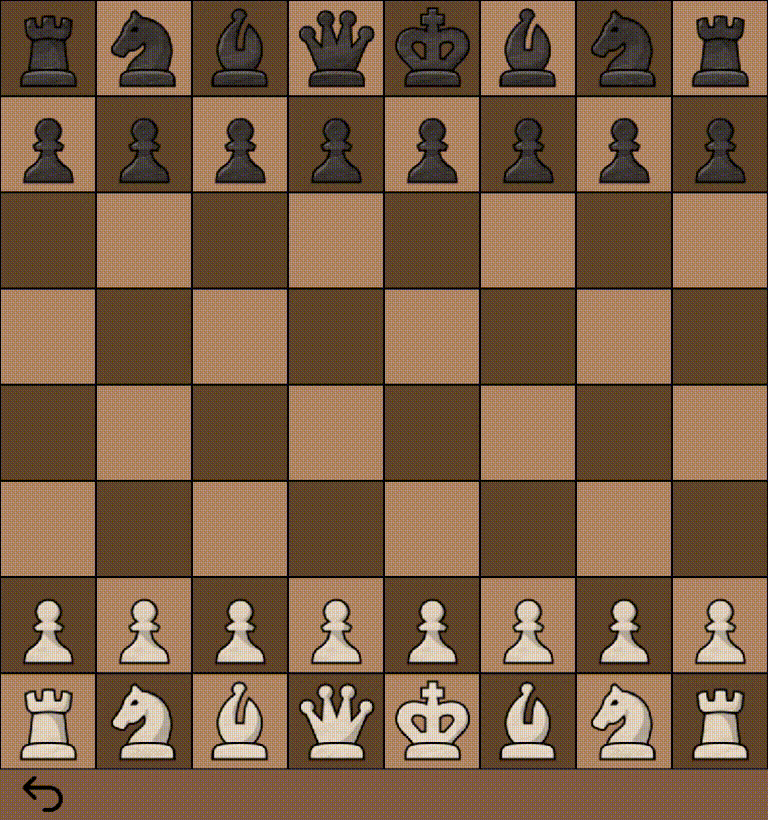

# ♟️ Chess Engine

A chess engine built from scratch in Python, with graphical interface using Pygame.

## Features

- **Chess Engine:** Custom implementation of chess logic (including castling and en passant) .
- **Graphical Interface:** Interactive skinable chessboard built with Pygame.
- **Move Generation:** Calculates possible moves for chess pieces.
- **Game State Management:** Tracks the board position and current turn.
- **Modular Structure:** Separates the engine logic from the graphical interface.
- **Future Development:** A foundation for implementing an AI opponent using Minimax and alpha-beta pruning.

## Demo

<table>
  <tr>
    <td align="center" width="50%">
      <strong>Legal Move Validation</strong>
    </td>
    <td align="center" width="50%">
      <strong>Castling &amp; En Passant</strong>
    </td>
  </tr>
  <tr>
    <td align="center">
      
    </td>
    <td align="center">
      
    </td>
  </tr>
</table>


## Getting Started

### Prerequisites

- Python
- Pygame

### Installation

1. Clone the repository:

   ```bash
   git clone https://github.com/Kaed-Blue/Chess-Game.git
   ```

2. Navigate to the project directory:

   ```bash
   cd Chess-Game
   ```

3. Install pygame in your env:

   ```bash
   pip install pygame
   ```

4. Run the application:

   ```bash
   python GUI.py
   ```


**note:** I've made the GUI and an API for web use with js too, it's deep in the chess-web repo; you would have to search for the html, css and js board files.